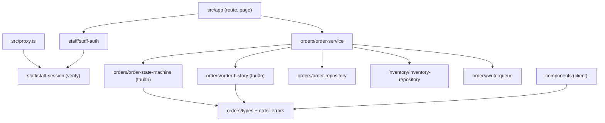
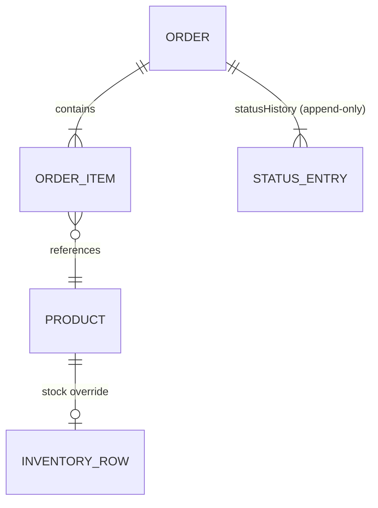
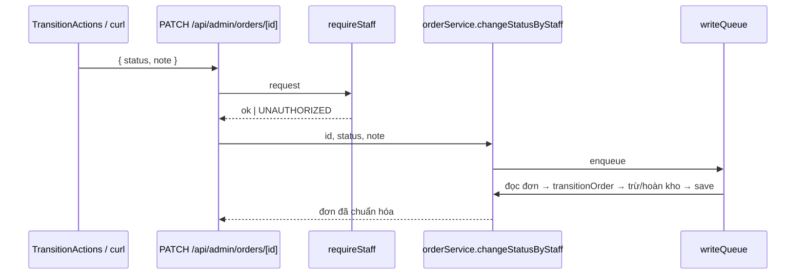

# Architecture Spine — ShopLite Ops

## Design Paradigm

Feature-based modular monolith trên Next.js 16 App Router. Mỗi feature là một thư mục `src/features/<feature>/` gồm **lõi thuần** (hàm không I/O, nhận `now` và dữ liệu làm tham số, test bằng Vitest không cần file) và **vỏ** (service điều phối repository, route handler, page). `src/app/` chỉ chứa page, layout, route handler mỏng.

| Lớp | Thư mục | Được phụ thuộc vào |
| --- | --- | --- |
| Route / Page (vỏ HTTP) | `src/app/**`, `src/proxy.ts` | service, auth, component |
| Service (điều phối) | `src/features/orders/order-service.ts` | lõi thuần, repository, write queue |
| Lõi thuần | `order-state-machine.ts`, `order-history.ts`, `staff-session.ts` (phần ký/kiểm tra) | `types.ts`, `order-errors.ts` |
| Repository (I/O) | `order-repository.ts`, `src/features/inventory/inventory-repository.ts` | `node:fs` |
| UI | `src/features/*/components/`, `src/components/` | type, hàm thuần dùng được ở client |

## Invariants & Rules



### AD-1 — Feature-based, route handler mỏng [ADOPTED]

- **Binds:** all
- **Prevents:** logic nghiệp vụ (chuyển trạng thái, trừ kho, xác thực) bị viết thẳng trong `src/app/**`, mỗi route một kiểu.
- **Rule:** logic mới nằm trong `src/features/orders/`, `src/features/inventory/`, `src/features/staff/`; file trong `src/app/**` chỉ đọc request, gọi đúng một hàm service/auth, trả response. Test đặt cạnh file nguồn (`*.test.ts`).

### AD-2 — Server là nguồn sự thật cho tiền, trạng thái và tồn kho [ADOPTED]

- **Binds:** FR-5, FR-10, FR-11, FR-12, all API
- **Prevents:** client gửi trạng thái nguồn, số tồn kho, giá hay `statusHistory` và server tin theo.
- **Rule:** body API nhân viên chỉ có `status` đích và `note`; trạng thái hiện tại, lịch sử, tồn kho luôn đọc lại từ repository bên trong service. `placeOrderSchema` không đổi.

### AD-3 — Lỗi nghiệp vụ qua OrderError và handleRouteError [ADOPTED]

- **Binds:** FR-1, FR-5, FR-6, FR-10
- **Prevents:** route tự dựng JSON lỗi hoặc dùng mã HTTP khác nhau cho cùng một lỗi.
- **Rule:** lỗi nghiệp vụ ném `OrderError(code, message, details?)`; route bọc `try/catch` và gọi `handleRouteError`. Mã mới duy nhất là `UNAUTHORIZED` (401), thêm vào `OrderErrorCode` + `HTTP_STATUS_BY_CODE`. Dùng lại `INVALID_STATUS_TRANSITION` (409, thêm `details.currentStatus`), `INSUFFICIENT_STOCK` (409; đường xác nhận đơn thêm `details.productId`, message giữ đúng câu hiện có của `placeOrder`), `ORDER_NOT_FOUND` (404), `VALIDATION_ERROR` (400).

### AD-4 — Mọi thay đổi trạng thái đi qua một hàm thuần duy nhất

- **Binds:** FR-1, FR-2, FR-3, FR-5, FR-9
- **Prevents:** route, UI hoặc `cancelOrder` cũ tự gán `status`; khách và nhân viên dùng hai bộ quy tắc khác nhau.
- **Rule:** chỉ `transitionOrder(order, to, { actor, at, note })` trong `src/features/orders/order-state-machine.ts` được tạo đơn có `status` mới; nó tra bảng `ALLOWED_TRANSITIONS` (đúng 5 cặp của PRD), chặn `from === to`, giới hạn `actor: "customer"` chỉ được `pending → cancelled`, và ném `OrderError("INVALID_STATUS_TRANSITION", ..., { currentStatus })` khi không hợp lệ. `cancelOrder` của khách gọi hàm này và giữ thông báo hiện có "Chỉ có thể hủy đơn hàng đang ở trạng thái Chờ xác nhận". Hàm không mutate đơn đầu vào.

### AD-5 — Lịch sử trạng thái nằm trong đơn, chỉ ghi thêm; đơn cũ suy ra khi đọc

- **Binds:** FR-3, FR-4, FR-13
- **Prevents:** lịch sử lưu file riêng lệch với đơn; đọc đơn cũ làm ghi lại `orders.json`; mỗi màn hình tự suy ra lịch sử một kiểu.
- **Rule:** `Order.statusHistory?: OrderStatusEntry[]` với `OrderStatusEntry = { status, at, actor: OrderActor | "system", note? }` (`OrderActor = "customer" | "staff"` dùng cho thao tác; `"system"` chỉ xuất hiện trong lịch sử). `placeOrder` tạo mục đầu `{ status: "pending", at: createdAt, actor: "customer" }`; `transitionOrder` nối thêm một mục có `at` = `updatedAt` mới. Ghi chú được lõi thuần kiểm tra (bỏ khoảng trắng hai đầu, rỗng → bỏ, > 200 ký tự → `VALIDATION_ERROR` với `details.note`) dù có đi qua Zod hay không. Đơn thiếu trường được chuẩn hóa bằng `withStatusHistory(order)` (lõi thuần) ở **mọi** đường đọc của service (`getOrder`, `listOrders`, staff list) thành `[{ status, at: updatedAt, actor: "system" }]`, không gọi `repository.save`. Bất biến: mục cuối có `status` = `order.status`.

### AD-6 — Tồn kho có repository riêng, chỉ order-service được trừ/hoàn

- **Binds:** FR-10, FR-11, FR-12
- **Prevents:** component hoặc route sửa tồn kho; trừ kho ở `placeOrder`; hoàn kho cho đơn chưa từng trừ.
- **Rule:** `InventoryRepository { getStock(productId), getAll(), applyChanges(changes) }` trong `src/features/inventory/inventory-repository.ts`, bản JSON ở `storage/inventory.json` (đường dẫn qua biến môi trường `INVENTORY_FILE`), bản in-memory cho test. Sản phẩm chưa có trong file dùng `stock` của `src/data/products.ts`. Chỉ `order-service` gọi `applyChanges`: trừ khi `pending → confirmed` (thiếu bất kỳ dòng nào thì ném `INSUFFICIENT_STOCK` trước khi ghi gì), hoàn khi `confirmed → cancelled`, không làm gì ở mọi bước khác. Tồn kho không bao giờ âm.

### AD-7 — Tuần tự hóa mọi chu trình đọc - sửa - ghi bằng một hàng đợi chung

- **Binds:** FR-10, NFR ghi đồng thời (PRD SM-2, SM-4)
- **Prevents:** hai request cùng đọc "còn hàng" rồi cùng trừ; khách đặt đơn và nhân viên xác nhận cùng lúc làm mất đơn.
- **Rule:** `createWriteQueue()` trong `src/features/orders/write-queue.ts` (promise chain, task lỗi không chặn task sau). `src/features/orders/server.ts` tạo **đúng một** instance và truyền vào `createOrderService`; service bọc **toàn bộ** thân `placeOrder`, `cancelOrder`, `changeStatusByStaff` (đọc đơn → kiểm tra → đọc/ghi tồn kho → lưu đơn) trong `queue(...)`. Đường đọc không cần hàng đợi. Phạm vi: một tiến trình Node.

### AD-8 — Xác thực nhân viên: một hàm, fail-closed, timing-safe

- **Binds:** FR-6, FR-7
- **Prevents:** route quên kiểm tra quyền; cho qua khi thiếu biến môi trường; so sánh chuỗi lộ thời gian.
- **Rule:** mọi route `src/app/api/admin/**` **trừ** `src/app/api/admin/session/route.ts` (đăng nhập/đăng xuất) gọi `requireStaff(request)` (`src/features/staff/staff-auth.ts`) trước khi đọc dữ liệu; hàm chấp nhận `Authorization: Bearer` khớp `STAFF_API_KEY` **hoặc** cookie phiên hợp lệ, ngược lại ném `OrderError("UNAUTHORIZED")`. Biến môi trường rỗng/thiếu → luôn từ chối. So sánh bí mật bằng `crypto.timingSafeEqual` sau khi kiểm tra độ dài. Page `/admin/**` kiểm tra lại bằng `getStaffSession()`; `src/proxy.ts` chỉ chuyển hướng `/admin/*` → `/admin/login` cho tiện, **không** phải lớp bảo mật.

### AD-9 — Phiên nhân viên là cookie ký HMAC, không lưu phía server

- **Binds:** FR-7, FR-9
- **Prevents:** cookie giả mạo hoặc không hết hạn; CSRF qua cookie trên API thay đổi dữ liệu.
- **Rule:** cookie `shoplite_staff` = `<expiresAtMs>.<hmacSha256Hex(expiresAtMs, STAFF_PASSWORD)>`, `HttpOnly`, `SameSite=Strict`, `Path=/`, `Secure` khi production, hết hạn 8 giờ. Khi xác thực bằng cookie, route thay đổi dữ liệu còn kiểm tra header `Origin` trùng host của request (thiếu `Origin` → từ chối). Đăng xuất = xóa cookie.

### AD-10 — Hợp đồng API nhân viên

- **Binds:** FR-5, FR-8, FR-9
- **Prevents:** trang vận hành và công cụ ngoài dùng hai API khác nhau; mở rộng nhầm `PATCH /api/orders/:id` của khách.
- **Rule:** `PATCH /api/admin/orders/:id` body `{ status: OrderStatus, note?: string }` validate bằng Zod `staffStatusChangeSchema` (`note: z.string().trim().max(200).optional()`) trong `src/features/orders/order-schema.ts` (cập nhật `AGENTS.md`: file Zod thứ ba được phép), trả đơn đã chuẩn hóa; `GET /api/admin/orders?status=` trả danh sách đã chuẩn hóa. `PATCH /api/orders/:id` của khách giữ nguyên.

## Consistency Conventions

| Concern | Convention |
| --- | --- |
| Naming | Tên file kebab-case; hàm service động từ + danh từ (`changeStatusByStaff`); type PascalCase (`OrderStatusEntry`, `OrderActor`); `data-testid` theo bảng trong EXPERIENCE.md |
| Thời gian | Mọi thời điểm là ISO 8601 UTC từ `now()` được inject vào service; một lần `now()` cho một thao tác (dùng chung cho `updatedAt` và `at` của mục lịch sử) |
| Lỗi | `{ error: { code, message, details? } }`; `details` là map phẳng chuỗi; thông báo tiếng Việt |
| Người thực hiện | `customer` cho `PATCH /api/orders/:id` và `placeOrder`; `staff` cho mọi đường `/api/admin/**`; `system` chỉ cho mục suy ra từ đơn cũ |
| Cấu hình | `STAFF_API_KEY`, `STAFF_PASSWORD` đọc lúc gọi hàm (không cache ở module scope) để test đổi được bằng `vi.stubEnv`; `ORDERS_FILE`, `INVENTORY_FILE` đọc một lần trong `server.ts` khi tạo singleton (như hiện có) - test thay repository bằng cách inject, không đổi biến môi trường |
| Test | Lõi thuần: test ma trận bằng bảng kỳ vọng viết tay (không dùng lại `ALLOWED_TRANSITIONS` làm đáp án); service: `createInMemoryOrderRepository` + in-memory inventory; đồng thời: `Promise.allSettled` thật; route: `// @vitest-environment node` |
| Client boundary | Component client chỉ import `types.ts`, `ORDER_STATUS_LABELS`, hàm thuần không I/O; không import `server.ts`, repository, `staff-auth.ts` |

## Stack

| Name | Version |
| --- | --- |
| Node.js | >= 22.12 |
| Next.js | 16.4.2 |
| React / React DOM | 19.3.0 |
| TypeScript | 5.9.3 |
| Tailwind CSS | 4.3.3 |
| Zod | 4.6.7 |
| lucide-react | 1.61.0 |
| Vitest | 5.0.5 |
| Playwright | 1.64.1 |

## Structural Seed





```text
src/
  proxy.ts                         # chuyển hướng /admin/* chưa đăng nhập (tiện lợi)
  app/admin/login/page.tsx
  app/admin/orders/page.tsx        # Hàng việc
  app/admin/orders/[id]/page.tsx   # chi tiết + thao tác
  app/api/admin/orders/route.ts    # GET danh sách
  app/api/admin/orders/[id]/route.ts  # PATCH đổi trạng thái
  app/api/admin/session/route.ts   # POST đăng nhập, DELETE đăng xuất
  features/orders/
    order-state-machine.ts         # transitionOrder, ALLOWED_TRANSITIONS (thuần)
    order-history.ts               # withStatusHistory (thuần)
    order-schema.ts                # staffStatusChangeSchema (Zod)
    write-queue.ts
    components/status-timeline.tsx
  features/inventory/
    inventory-repository.ts
  features/staff/
    staff-auth.ts                  # requireStaff (server)
    staff-session.ts               # ký / kiểm tra cookie
    components/                    # login form, transition actions, order row
storage/
  orders.json                      # có sẵn
  inventory.json                   # mới, tự tạo ở lần ghi đầu
```

## Deferred

- **Database / nhiều tiến trình:** hàng đợi trong bộ nhớ chỉ đúng với một tiến trình; chuyển sang database có transaction khi cần scale.
- **File tạm `orders.json.tmp` dùng chung** (có từ trước): AD-7 đã tuần tự hóa mọi lần ghi trong tiến trình; đổi sang tên file tạm duy nhất là việc riêng.
- **Tài khoản từng nhân viên, phân quyền, giới hạn số lần đăng nhập sai:** chờ có nhân viên thứ hai.
- **Thu hồi phiên phía server:** cookie đã sao chép vẫn hợp lệ tới khi hết hạn 8 giờ sau khi đăng xuất; đổi `STAFF_PASSWORD` là cách thu hồi mọi phiên.
- **Quyền riêng tư đơn hàng của khách** (`/orders` liệt kê mọi đơn): sáng kiến riêng, không thuộc spine này.
- **Nhập hàng qua giao diện:** sửa `storage/inventory.json` khi server dừng.
- **Xác nhận hàng loạt, in phiếu giao:** v2 theo PRD.
